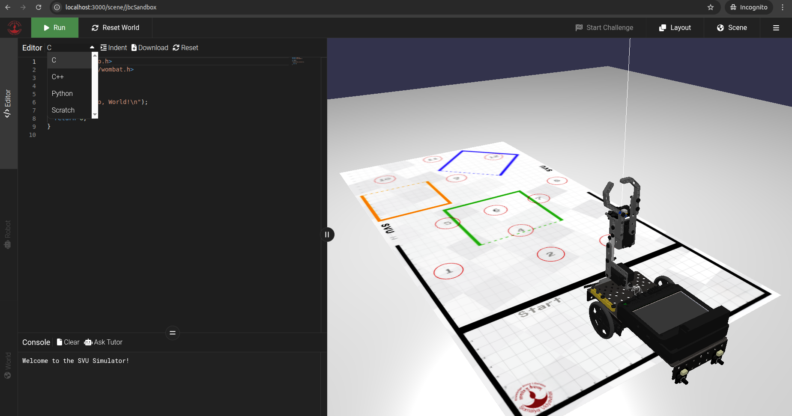
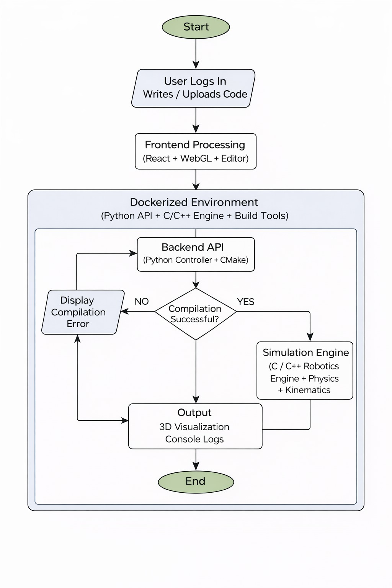
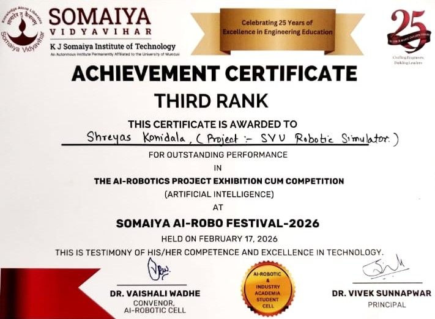

# Project evidence and presentation materials

This folder contains selected images and documents associated with the SVU Simulator project and its presentation. They serve as illustrations and historical evidence; they are not a substitute for the source code, build instructions, or license notices.

## Simulator result

Screenshot of the simulator running at `localhost:3000`. It documents a local run of this project copy. It does not by itself establish operation on other systems or verify every feature shown in the interface.

## Workflow illustration

Conceptual workflow illustration prepared for project communication. It is not an implementation diagram verified against the source. In particular, references in the graphic to a Python API/controller and specific compilation paths should not be treated as confirmed architecture; consult the repository's `Dockerfile`, `express.js`, and source tree for implementation details.

## Festival poster

[Somaiya AI-Robo Festival 2026 project poster (PDF)](somaiya-ai-robo-festival-2026-poster.pdf)

Archived as a record of the project presentation at the festival. Descriptions in the poster are presentation claims and are not independently verified by this repository. Use the README and source code for the setup and implementation details supported by this upload.

## Achievement certificate

Certificate documenting the third-rank award for the SVU Robotic Simulator project at Somaiya AI-Robo Festival 2026, held February 17, 2026. The image contains the recipient's name and is included as project achievement evidence.

